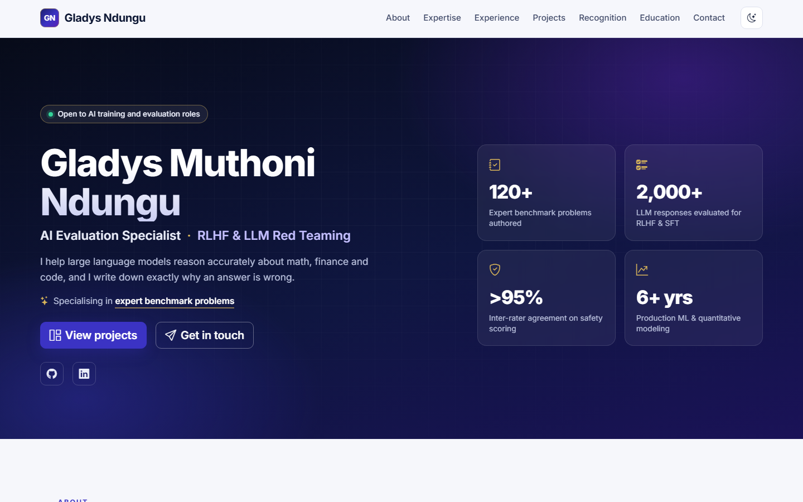
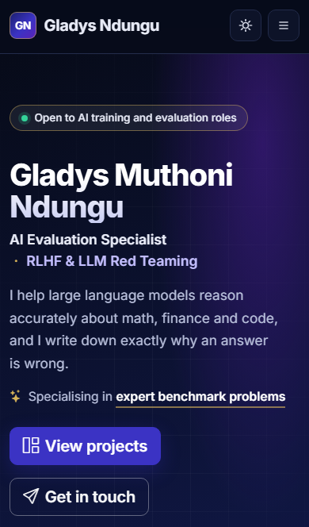

# Gladys Ndungu: portfolio

The personal site of Gladys Muthoni Ndungu, AI evaluation specialist (RLHF and LLM red
teaming) and Stanford PhD in Computational Finance.

<p>
  
  
</p>

## How it is built

| Layer | Choice |
|---|---|
| Content | [`db.json`](db.json), the single source of every word on the page |
| UI | React 19 (JSX) with Vite 8 |
| Styling | Bootstrap 5 for layout and components, Tailwind 3 for a few utilities, Inter font |
| Icons | Bootstrap Icons as a font, subset at build time to the 38 icons used |
| Contact | Netlify Forms; no email address or phone number is published |
| Hosting | Netlify (static) |

There is no backend. The site is static, `db.json` is bundled into it at build time, and
Netlify Forms receives the contact form. So no server-side language is needed.

### How Bootstrap and Tailwind share the page
Every Tailwind class carries a `tw-` prefix, and Tailwind's CSS reset is turned off, so
the two never fight over class names or base styles.

### Performance choices
* **Content is built in.** `db.json` is part of the JavaScript bundle, so the page makes
  no data request, shows no loading state, and nothing jumps around while data arrives.
* **Scroll effects use one shared observer.**
  * The fade-in animations and the navbar's current-section highlight each use a single
    `IntersectionObserver`, not one scroll listener per element.
  * A scroll listener per element costs O(n) work on every scroll event; the browser
    reports only the elements that cross the threshold.
* **The focus filter is precomputed.** A map from each focus area to the skills, roles and
  projects tagged with it is built once (O(total tags)). After that, each item checks
  whether it matches in O(1). A test builds the index over 20,000 items to confirm it
  stays linear.
* **Direct page updates skip React.**
  * The reading-progress bar and the rotating headline update the page through refs.
  * The progress bar's scroll handler schedules at most one update per animation frame
    and changes only a CSS transform.
  * Neither causes a React re-render while scrolling.
* **One click handler for the menu.** The navbar handles clicks with a single handler on
  the menu, not one per link.
* **Unused code is trimmed at build time.**
  * PurgeCSS removes unused Bootstrap rules, taking the CSS from 324 KB to 75 KB
    (19 KB gzipped).
  * The icon font is cut from 131 KiB to 3.8 KiB, small enough to be inlined into the
    CSS.

### Measured results
Measured on 2026-11-13 against the production build served locally, without
compression. Netlify compresses files, so the live site should do slightly better.

* **Lighthouse 12 (mobile, simulated throttling):**
  * Performance 99, Accessibility 100, Best Practices 100, SEO 100;
  * largest contentful paint 1.7 s, total blocking time 10 ms, layout shift 0.001.
* **axe-core accessibility audit (WCAG 2.2 A/AA):** 0 violations on desktop and mobile, in
  light and dark themes.
* **Page weight:** 373 KiB transferred uncompressed for the whole first load.

## Run it locally

You need Node.js 22+.

```bash
cd frontend
npm ci
npm run dev        # http://localhost:5173
```

The contact form only delivers messages on Netlify. Locally it validates and posts, but
nothing is stored.

## Tests

```bash
cd frontend
npm test                         # 70 tests (Vitest + Testing Library)
npm run build && npm run preview # production build on http://localhost:4173
npm run audit                    # in a second terminal: axe-core, console/CSP errors, page weight, screenshots
```

What the tests check:
* **Content rules in `db.json`:**
  * the confidential client names never appear;
  * no email address or phone number appears;
  * every focus area exists, dates are valid and ordered, and repo links point to
    Gladys-thee-dev;
  * every icon name is a real Bootstrap Icons name.
* **Logic:**
  * the focus index, including the 20,000-item linear-time check;
  * date formatting;
  * contact-form validation and the request format Netlify Forms expects.
* **Components:**
  * every section renders from `db.json`, and no `mailto:` or `tel:` link is rendered;
  * the focus filter, the collapsible role highlights, the navbar's current section and
    mobile menu, and the theme toggle;
  * the contact form's success and failure paths.
* **Colour contrast:** every text/background pair in both themes meets WCAG AA (4.5:1).
  The colours are read from the stylesheet itself, so the test and the CSS can't drift
  apart.
* **Security:**
  * the Content Security Policy allows only the inline script in `index.html`, by its
    hash;
  * the preview server sends the same policy, and the browser audit fails on any
    violation.

CI ([`.github/workflows/ci.yml`](.github/workflows/ci.yml)) runs the tests, the build and
the browser audit on every push.

## Deploying on Netlify

[`netlify.toml`](netlify.toml) holds all the settings. It runs the tests before every
build, so a failing change is never published. It also sets the security headers and
long-term caching for fingerprinted files.

1. In Netlify: **Add new site → Import an existing project → GitHub → Gladys-thee-dev/Portfolio**.
2. Keep the settings it reads from `netlify.toml` and deploy.
3. In **Forms**, enable form detection if it is not already on, then set up
   **notifications** to send new messages to Gladys's inbox. The address stays private.

## Editing content

Change [`db.json`](db.json) and push. The tests run before Netlify publishes. They reject:
* a confidential client name;
* contact details;
* a focus area that doesn't exist;
* an icon name that doesn't exist.

## License

The code is under the [MIT License](LICENSE). The written content and personal
information in `db.json` belong to Gladys Muthoni Ndungu and are not covered by that
license.
